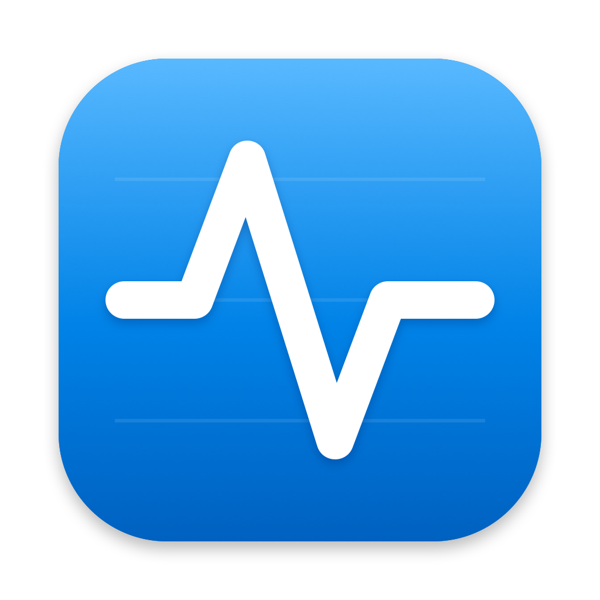
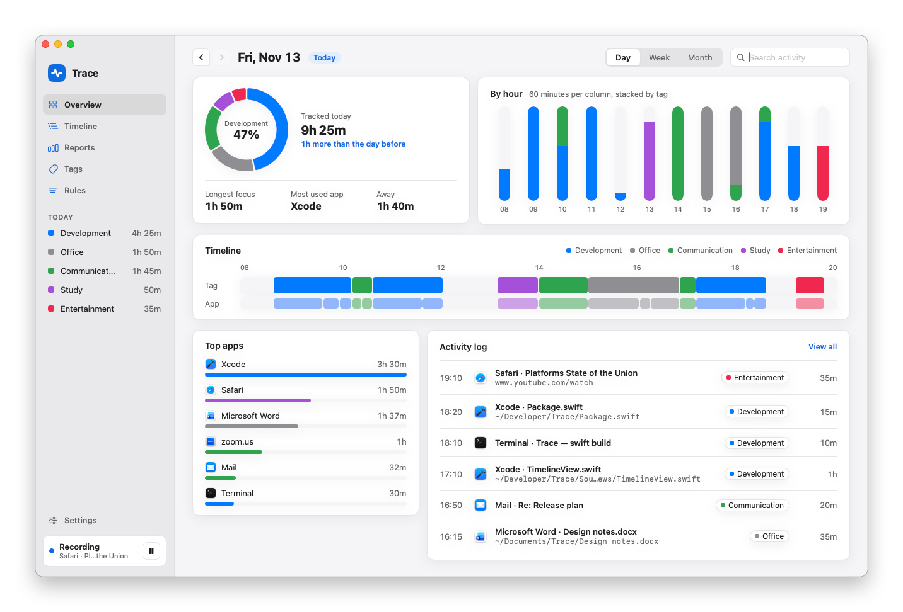
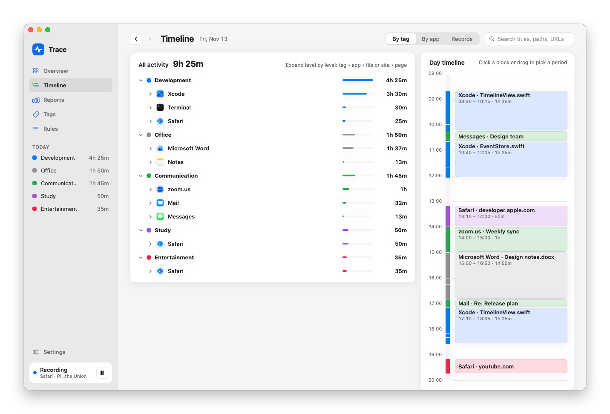
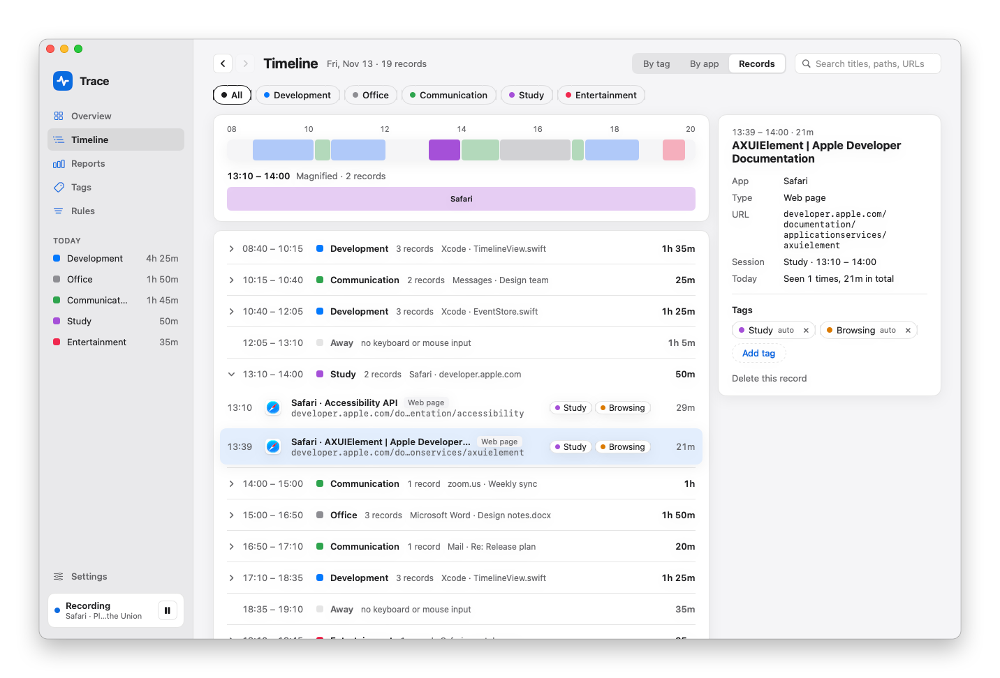
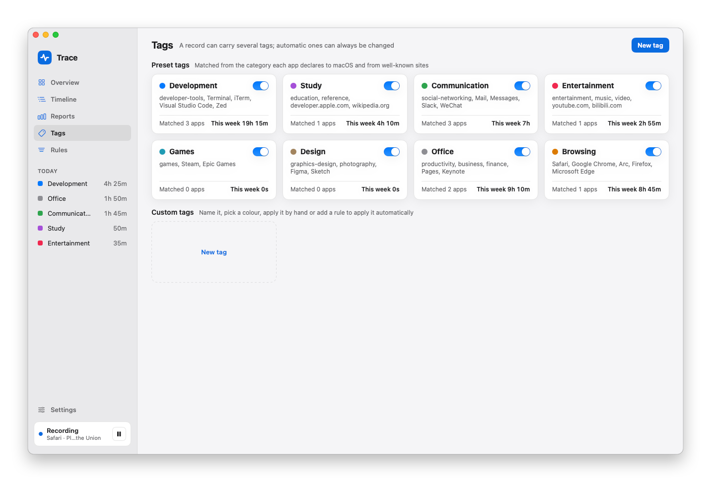
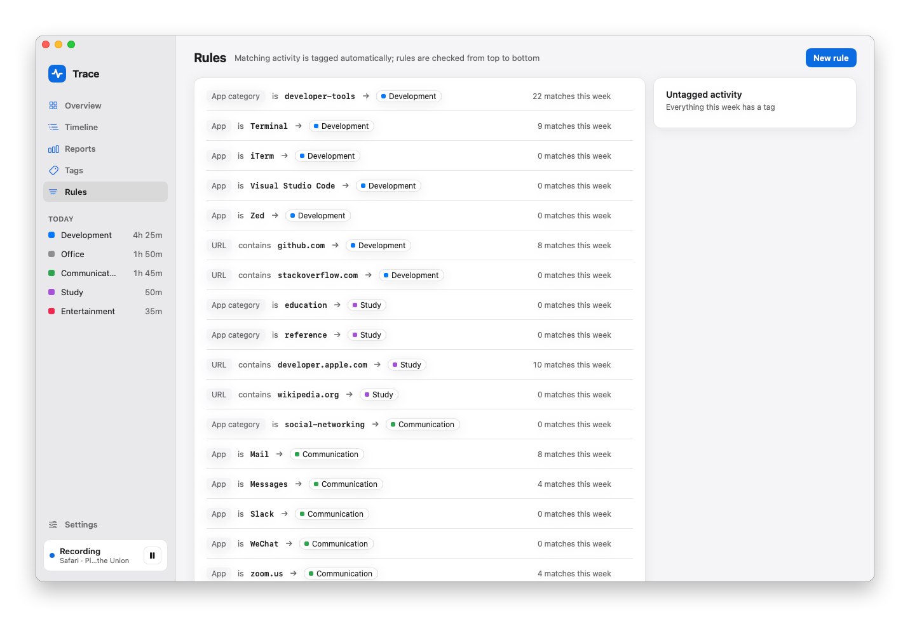
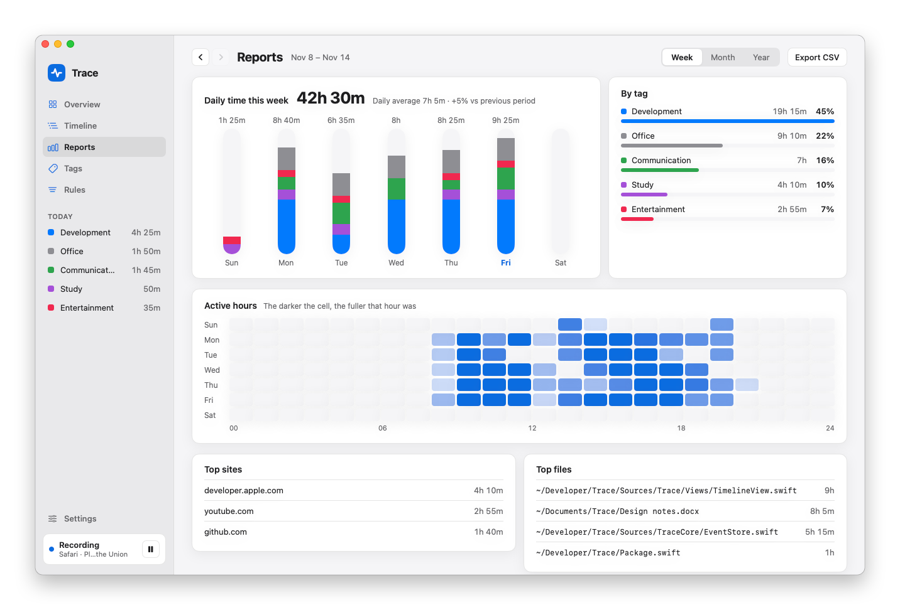
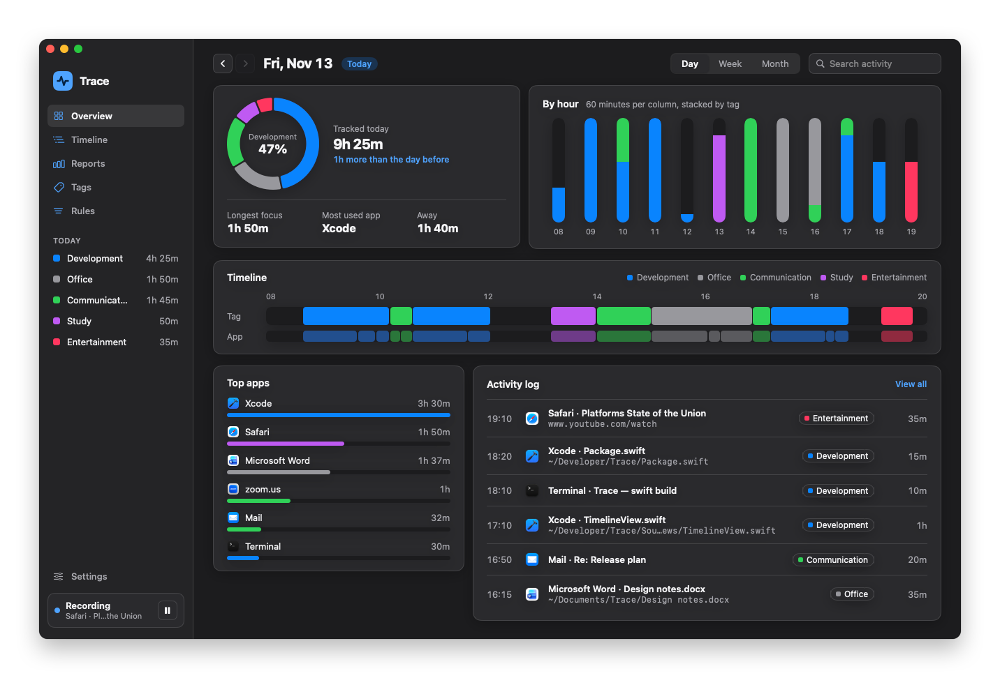
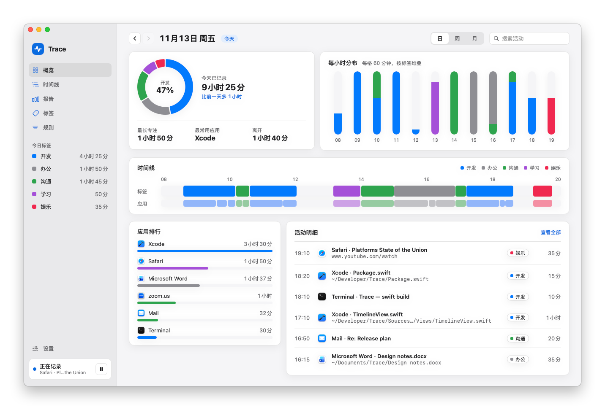

<p align="center">
  
</p>

<h1 align="center">Trace</h1>

<p align="center">
  An open-source activity tracker for macOS that keeps everything on your Mac.<br>
  开源的 macOS 活动记录工具，数据只保存在本机。
</p>

<p align="center">
  <a href="https://github.com/lxyeternal/Trace/releases/latest">Download</a> ·
  <a href="#features">Features</a> ·
  <a href="#privacy">Privacy</a> ·
  <a href="#build-from-source">Build from source</a> ·
  <a href="#中文说明">中文说明</a>
</p>



Trace sits in the menu bar and records which app, window, file and web page is in front of you, and for how long. There are no timers to start and nothing to fill in. At the end of the day it shows where the time went, down to the single file or page.

## Features

### A detailed timeline

Expand the day level by level: tag › app › file or site › page. The day runs top to bottom on the right; click a session or drag across any stretch of it, and the outline sums up only that period.



### Every record, one by one

Switch to Records to read the day stay by stay. Sessions group the records that belong together, and a brief glance at another app does not split a session. Select a record to see its file path or URL, how often you came back to it, and its tags.



### Tags that apply themselves

Eight built-in tags (Development, Office, Study, Communication, Entertainment, Games, Design, Browsing) work from the first launch, based on the category each app declares to macOS and a short list of well-known apps and sites. Add your own tags, give them rules on the app, file path, URL or window title, or tag a single record by hand. Rules are applied when reading, so changing one re-tags your whole history.

| Tags | Rules |
|---|---|
|  |  |

### Reports

A week, a month or a year at a glance: time per day stacked by tag, the hours you are usually active, and the sites and files you spent the most time on. Any period can be exported as CSV.



### Made for the Mac

Native SwiftUI, light and dark appearance, English and Simplified Chinese (switchable without restarting), a menu bar panel with today's total, and launch at login.

| Dark | 简体中文 |
|---|---|
|  |  |

## Privacy

- **Local only.** Everything is stored in one SQLite file at `~/Library/Application Support/Trace/trace.sqlite`. Trace makes no network connections and has no account.
- **No keystrokes, no screenshots.** Trace reads the name of the app in front and, through the macOS Accessibility API, the title, document path and page address of its focused window. Nothing else.
- **URLs without the sensitive part.** Query strings, fragments and credentials are removed before a URL is stored.
- **You choose what is recorded.** Window titles, file paths and web addresses can each be turned off, and any app can be excluded completely.
- **Your data is yours.** Export it as CSV or erase it from Settings at any time.

## Install

Requires macOS 14 or later, on Apple silicon or Intel.

1. Download the `.dmg` from the [latest release](https://github.com/lxyeternal/Trace/releases/latest).
2. Open it and drag Trace to Applications.
3. Start Trace. It asks for **Accessibility** access (System Settings › Privacy & Security › Accessibility); without it Trace still records which app is in front, but not window titles, file paths or URLs.

If macOS says it cannot verify Trace, the build you downloaded is not notarized by Apple. Open System Settings › Privacy & Security, scroll to the message about Trace and click **Open Anyway**. You only need to do this once.

## Build from source

Needs Xcode 16 or later.

```bash
git clone https://github.com/lxyeternal/Trace.git
cd Trace
scripts/bundle.sh
open build/Trace.app
```

The default build is ad-hoc signed, so macOS asks for Accessibility access again after every rebuild. To avoid that, put the name of one of your signing certificates (see `security find-identity -v -p codesigning`) in a file named `.codesign-identity` in the repository root; the file is ignored by git.

Useful commands:

| Command | What it does |
|---|---|
| `swift test` | Runs the unit tests of the core library. |
| `open -n build/Trace.app --args --demo` | Opens Trace with made-up data, without recording anything. |
| `scripts/release.sh` | Builds a universal app and packages it as a DMG and a zip. |
| `swift scripts/make-icon.swift` | Redraws the app icon. |

## How it works

| Part | Where | What it does |
|---|---|---|
| Capture | `Sources/Trace/Capture` | Reads the frontmost app from `NSWorkspace`, the focused window through the Accessibility API, and idle time from `CGEventSource`, every two seconds. |
| Storage | `Sources/TraceCore/EventStore.swift` | SQLite via [GRDB](https://github.com/groue/GRDB.swift). Consecutive identical samples extend one event, so there is one row per stay. Idle time is not stored; it appears as gaps. |
| Tagging | `Sources/TraceCore/Tagging.swift` | Rules match on app, app category, file path, URL or window title. Tags added or removed by hand on a single record override the rules. |
| Analysis | `Sources/TraceCore/Analyzer.swift` | Day summary, sessions, the drill-down outline, reports and CSV export. |
| Interface | `Sources/Trace/Views` | SwiftUI. Colours and shared controls live in `Theme.swift`. |

`TraceCore` has no user interface and is covered by unit tests; the app target adds capture and the interface on top of it.

## Adding a language

Copy `Resources/zh-Hans.lproj` to `Resources/<code>.lproj`, translate the right-hand side of each line, then add the code to `CFBundleLocalizations` in `Support/Info.plist` and to `AppLanguage` in `Sources/Trace/Localization.swift`. The English text is the key, so nothing else needs to change.

## Known limitations

- Watching a video without touching the keyboard or mouse counts as away once the idle time has passed.
- Private browsing windows are not detected and are recorded like any other window. Exclude the browser or turn off web addresses if that matters to you.
- Page addresses depend on what each browser exposes to the Accessibility API. Safari and Chromium-based browsers (Chrome, Edge, Arc, Brave) are covered; others may only report the window title.

## Contributing

Issues and pull requests are welcome. Please run `swift test` before opening a pull request, and keep new interface text in both `en` and `zh-Hans`.

## 中文说明

Trace 驻留在菜单栏，自动记录你正在使用的应用、窗口、文件和网页以及停留时长，不需要手动开始计时。

- **详细的时间线**：按 标签 › 应用 › 文件或网站 › 页面 逐层展开；点选或拖选一天中的任意一段，只汇总这一段。
- **逐条记录**：按时段分组查看每一次停留，可以查看文件路径、网址，并给单条记录加减标签。
- **自动标签**：内置开发、办公、学习、沟通、娱乐、游戏、设计、浏览八个标签，装好即用；也可以自建标签和规则，修改规则后历史记录同步生效。
- **报告**：按周、月、年查看每日时长、活跃时段、常用网站和文件，可导出 CSV。
- **隐私**：数据只保存在本机的一个 SQLite 文件里；不联网、没有账号；不记录按键和屏幕内容；网址保存前会去掉查询参数。
- **原生体验**：SwiftUI，支持浅色、深色和跟随系统，中英文可即时切换。

安装：从 [Releases](https://github.com/lxyeternal/Trace/releases/latest) 下载 `.dmg` 文件，拖到“应用程序”，首次启动时在 系统设置 › 隐私与安全性 › 辅助功能 中允许 Trace。如果系统提示无法验证，请到 系统设置 › 隐私与安全性 里点击“仍要打开”。

## License

[MIT](LICENSE)
