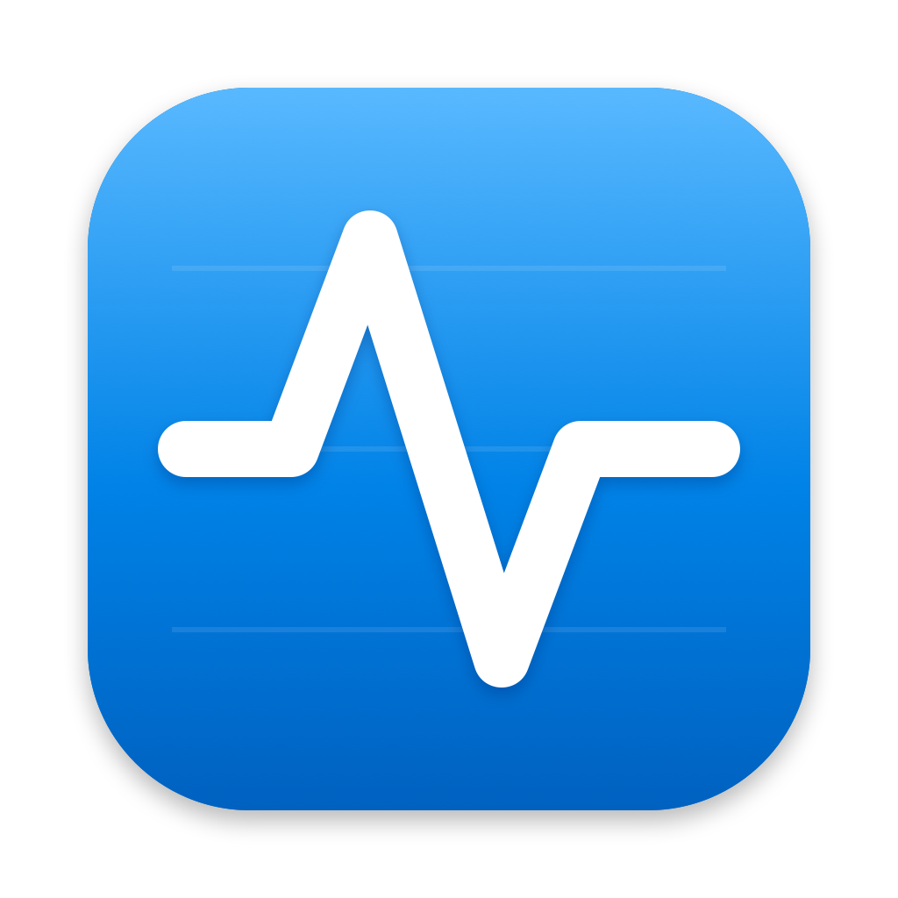
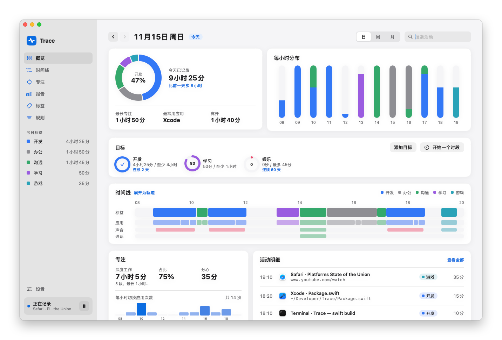
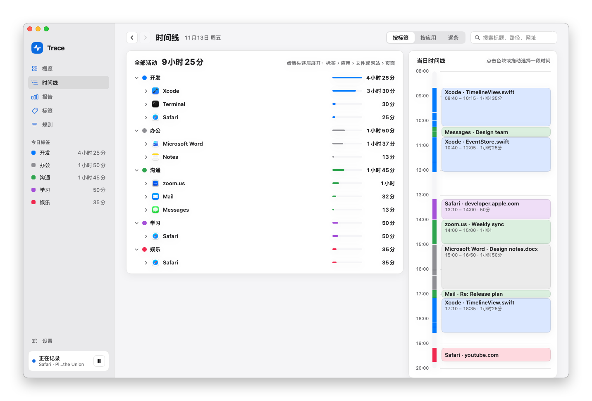
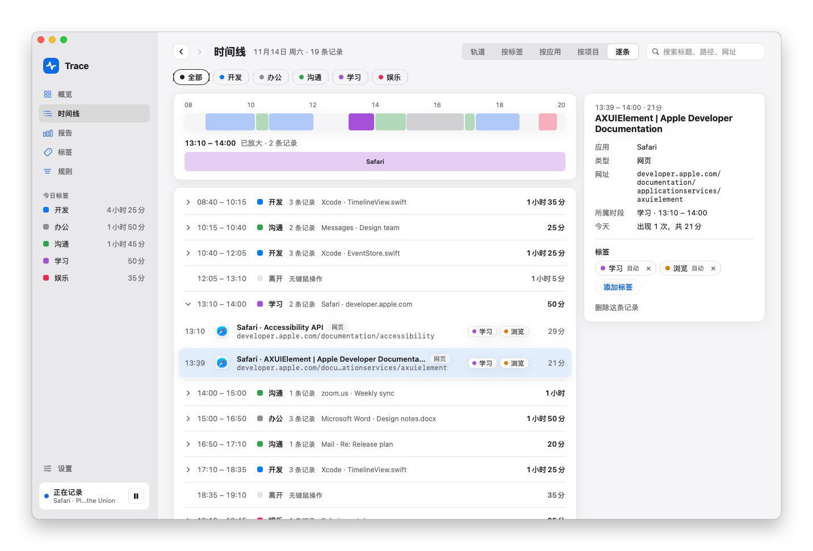
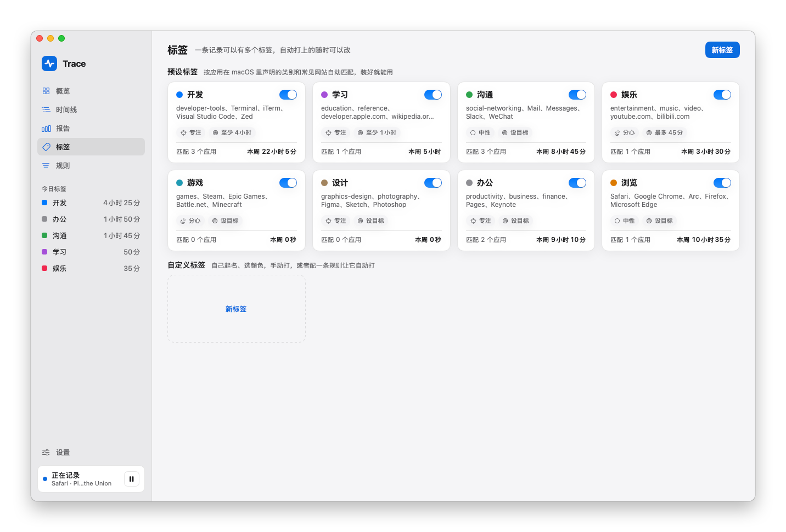
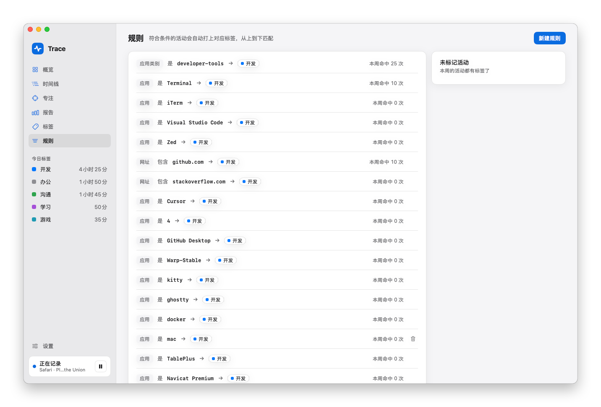
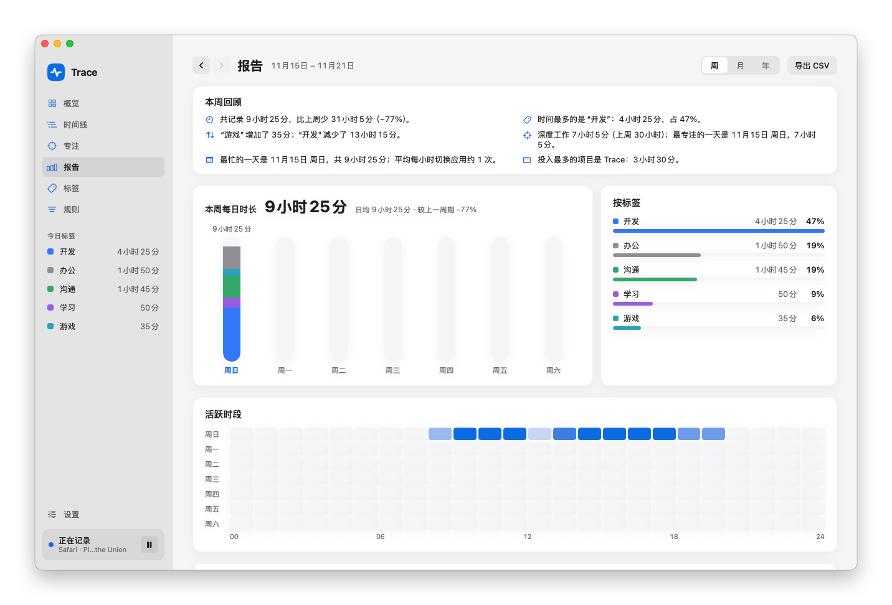
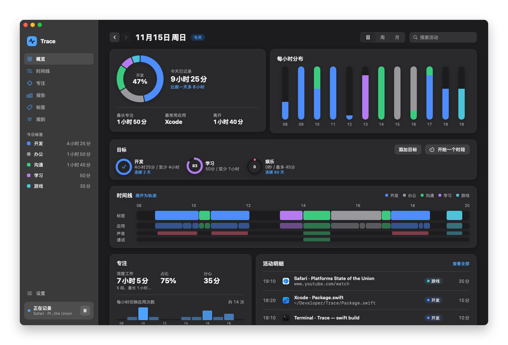
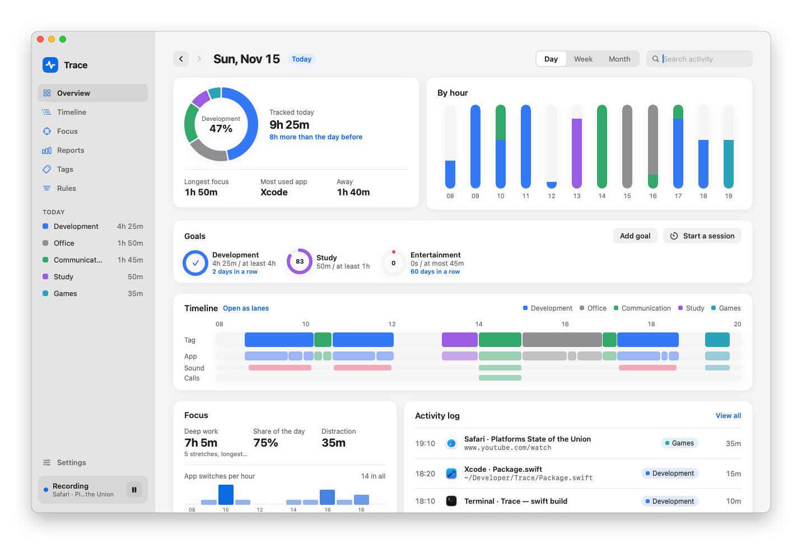

<p align="center">
  
</p>

<h1 align="center">Trace</h1>

<p align="center">
  开源的 macOS 活动记录工具，所有数据只保存在你的 Mac 上。
</p>

<p align="center">
  <a href="README.md">English</a> · <b>简体中文</b>
</p>

<p align="center">
  <a href="https://github.com/lxyeternal/Trace/releases/latest">下载</a> ·
  <a href="#功能">功能</a> ·
  <a href="#隐私">隐私</a> ·
  <a href="#安装">安装</a> ·
  <a href="#从源码构建">从源码构建</a>
</p>



Trace 驻留在菜单栏，自动记录你面前是哪个应用、哪个窗口、哪个文件、哪个网页，以及停留了多久。不需要手动开始计时，也不需要填写任何东西。一天结束时，它告诉你时间花在了哪里，可以细到某一个文件或某一个页面。

## 功能

### 详细的时间线

按 标签 › 应用 › 文件或网站 › 页面 逐层展开一天的活动。右侧是从上到下的当日时间线：点一个时段，或者在上面拖出任意一段，左侧就只汇总这一段时间。



### 逐条查看每一次停留

切换到“逐条”，可以按顺序查看每一次停留。相关的记录会归到同一个时段里，中途切出去看一眼别的应用不会把时段拆开。选中一条记录，可以看到它的文件路径或网址、当天出现了几次，以及它的标签。



### 自动打标签

内置八个标签：开发、办公、学习、沟通、娱乐、游戏、设计、浏览。它们根据每个应用向 macOS 声明的类别，以及一份常见应用和网站的清单来匹配，装好就能用。你也可以新建自己的标签，按应用、文件路径、网址或窗口标题设置规则，或者给单条记录手动加减标签。规则在读取数据时才计算，所以修改一条规则，全部历史记录都会跟着更新。

| 标签 | 规则 |
|---|---|
|  |  |

### 报告

按周、月、年查看：每天的时长（按标签堆叠）、通常在哪些时段活跃、花时间最多的网站和文件。任何一段时间都可以导出为 CSV。



### 原生的 Mac 体验

使用 SwiftUI 编写，支持浅色、深色和跟随系统；界面有简体中文和英文，切换后立即生效，不需要重启；菜单栏面板可以随时查看今天的总时长；支持登录时自动启动。

| 深色外观 | 英文界面 |
|---|---|
|  |  |

## 隐私

- **只存本机。** 所有数据保存在一个 SQLite 文件里：`~/Library/Application Support/Trace/trace.sqlite`。Trace 不联网，也没有账号。
- **不记录按键，不截屏。** Trace 只读取前台应用的名称，并通过 macOS 的辅助功能接口读取当前窗口的标题、文档路径和页面地址，除此之外什么都不读。
- **网址会去掉敏感部分。** 保存之前会去掉查询参数、锚点和账号密码。
- **记录什么由你决定。** 窗口标题、文件路径、网址可以分别关闭，任何应用都可以完全排除。
- **数据属于你。** 随时可以在设置里导出为 CSV，或者全部清除。

## 安装

需要 macOS 14 或更高版本，支持 Apple 芯片和 Intel。

1. 从[最新发布](https://github.com/lxyeternal/Trace/releases/latest)下载 `.dmg` 文件。
2. 打开它，把 Trace 拖到“应用程序”文件夹。
3. 启动 Trace。它会请求**辅助功能**权限（系统设置 › 隐私与安全性 › 辅助功能）。不授权也能记录前台是哪个应用，但读不到窗口标题、文件路径和网址。

发布的安装包使用 Developer ID 证书签名，并经过 Apple 公证，打开时不会出现安全警告。

## 从源码构建

需要 Xcode 16 或更高版本。

```bash
git clone https://github.com/lxyeternal/Trace.git
cd Trace
scripts/bundle.sh
open build/Trace.app
```

默认构建使用临时签名，所以每次重新构建后，macOS 都会要求重新授予辅助功能权限。想避免这一点，可以把你的一个签名证书的名称（用 `security find-identity -v -p codesigning` 查看）写进仓库根目录下名为 `.codesign-identity` 的文件，这个文件已被 git 忽略。

常用命令：

| 命令 | 作用 |
|---|---|
| `swift test` | 运行核心库的单元测试。 |
| `open -n build/Trace.app --args --demo` | 用虚构的数据打开 Trace，不记录任何真实活动。 |
| `scripts/release.sh` | 构建通用版本的应用，并打包成 DMG 和 zip。 |
| `swift scripts/make-icon.swift` | 重新绘制应用图标。 |

## 工作原理

| 部分 | 位置 | 作用 |
|---|---|---|
| 采集 | `Sources/Trace/Capture` | 每两秒从 `NSWorkspace` 读取前台应用，通过辅助功能接口读取当前窗口，从 `CGEventSource` 读取空闲时间。 |
| 存储 | `Sources/TraceCore/EventStore.swift` | 通过 [GRDB](https://github.com/groue/GRDB.swift) 使用 SQLite。连续相同的采样会延长同一条记录，所以每次停留只有一行。空闲时间不保存，表现为记录之间的空隙。 |
| 标签 | `Sources/TraceCore/Tagging.swift` | 规则可以匹配应用、应用类别、文件路径、网址或窗口标题。对单条记录手动加减的标签优先于规则。 |
| 分析 | `Sources/TraceCore/Analyzer.swift` | 每日汇总、时段划分、层级汇总、报告和 CSV 导出。 |
| 界面 | `Sources/Trace/Views` | SwiftUI。颜色和通用控件在 `Theme.swift` 里。 |

`TraceCore` 不包含界面，有单元测试覆盖；应用部分在它之上加入采集和界面。

## 添加一种语言

把 `Resources/zh-Hans.lproj` 复制为 `Resources/<语言代码>.lproj`，翻译每一行等号右边的内容，然后把语言代码加到 `Support/Info.plist` 的 `CFBundleLocalizations` 和 `Sources/Trace/Localization.swift` 的 `AppLanguage` 里。英文原文就是键，其他地方不需要改。

## 已知限制

- 不碰键盘和鼠标看视频，超过空闲判定时长后会被记为离开。
- 无法识别浏览器的无痕窗口，会和普通窗口一样记录。如果介意，可以排除该浏览器，或者关闭网址记录。
- 能否读到页面地址，取决于浏览器向辅助功能接口暴露了什么。Safari 和基于 Chromium 的浏览器（Chrome、Edge、Arc、Brave）可以读到；其他浏览器可能只有窗口标题。

## 参与贡献

欢迎提交 issue 和 pull request。提交 pull request 之前请先运行 `swift test`，新增的界面文字请同时提供英文和简体中文。

## 许可证

[MIT](LICENSE)
